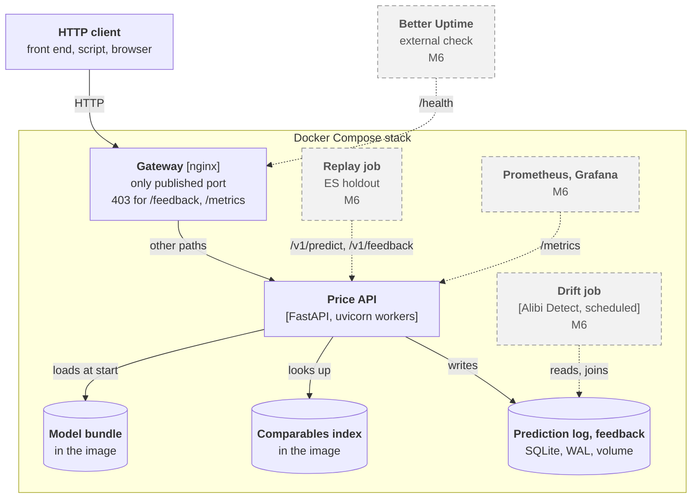
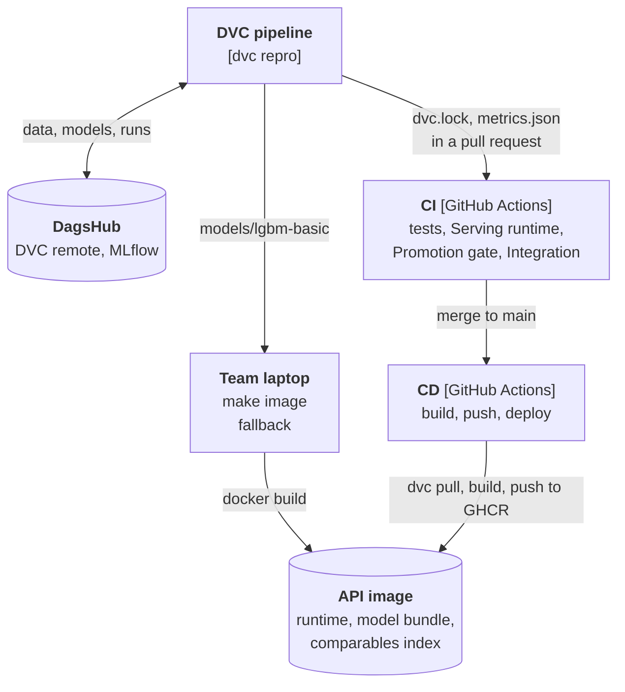
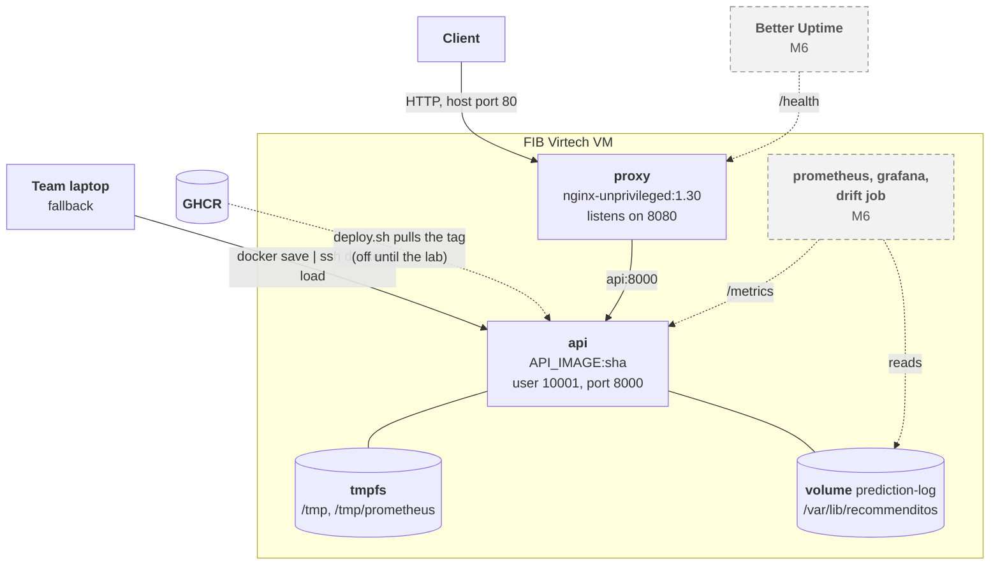

Architecture
============

This page shows how the price component is built in two views: the logical view, which containers there are and how they talk ([C4](https://c4model.com/) container level), and the physical view, where they run.
It then names the architectural patterns, what the design leaves out, and the decisions behind both, with their entries in the [Engineering Decision Notebook][edn] (EDN).
What each part must do is in the [specification](specification.md); how to run the API and the stack is in [The API](api.md) and [Deployment](deployment.md).

Every element is in one of two states, and the diagrams draw them differently:

| State | Drawn as | Meaning |
|-------|----------|---------|
| Built | Solid border | On `main` |
| Planned | Grey, dashed border | Milestone 5 or 6, named in the label |

A dashed line is a connection that does not exist yet.

## Logical view: containers

The system has two halves that meet only in the API image: the containers that answer requests, and the pipeline and checks that build and deliver that image.

### Runtime containers

### Build and delivery

| Container | Responsibility | State, code |
|-----------|----------------|-------------|
| **Gateway** (nginx 1.30, unprivileged) | Publishes the stack's only port; answers `/feedback` and `/metrics` with 403; sets security headers; its own errors are RFC 9457 problems | Built, `deploy/nginx.conf` |
| **Price API** (FastAPI, uvicorn; `WEB_CONCURRENCY` workers) | Validates and prices a request and explains the price (FR-08); `/v1/predict`, `/v1/price-range`, `/v1/comparables`, `/v1/feedback`, `/`, `/health`, `/metrics`, `/docs` | Built, `recommenditos/api/` |
| **Model bundle** (directory in the image) | UC1 and UC2 boosters, interval offsets, feature pipeline; `/health` reports its `dvc.lock` hash (FR-12) | Built, `Dockerfile`, `modeling/model.py` |
| **Comparables index** (`data/processed/comparables.parquet`, copied into the image) | The training and validation listings `/v1/comparables` searches (FR-09) | Built, `recommenditos/data/build_comparables.py` (stage `comparables`), `recommenditos/api/comparables.py` |
| **Prediction log and feedback** (SQLite in WAL mode, named volume) | One row per answer (FR-13) and per observed price (FR-10), joined by request ID (FR-14) | Built, `api/prediction_log.py` |
| **Replay job** | Sends the `ES` holdout as requests and its prices as feedback (NFR-11) | M6 |
| **Drift job** (Alibi Detect, scheduled container) | Input drift, error and interval coverage per window of logged requests (FR-14, EDN-14) | M6 |
| **Prometheus and Grafana** | Scrape `/metrics` inside the network; show latency, errors and resources | M6 |
| **Better Uptime** | Checks `/health` from outside during the presentation windows (NFR-05, proposed) | M6 |
| **DVC pipeline** | Turns the raw listings into the model bundle, its metrics and the gate's verdict | Built, `dvc.yaml`, [pipeline](pipeline.md) |
| **DagsHub** | DVC remote for data and models; hosted MLflow for every run | Built, [data versioning](data-versioning.md) |
| **CI** (GitHub Actions) | On every pull request: lint, tests on Linux and Windows, Serving runtime, Promotion gate, integration tests through nginx | Built, `.github/workflows/ci.yml` |
| **CD** (GitHub Actions, GHCR) | On a merge to `main`: builds and pushes the image, deploys it to the VM, runs the smoke check and puts the previous tag back if it fails (NFR-13) | Built, `.github/workflows/cd.yml` and `deploy.yml`; deploying is off until the VM is configured ([Deployment](deployment.md#turn-continuous-deployment-on)) |

The API calls no other service at request time: no DagsHub, no MLflow.
The state it keeps outside the image is the prediction log on its volume and the workers' metric files in a tmpfs, so a worker or the whole container can be restarted or replaced without losing a request's context.

## Physical view: deployment

- **The VM.** One FIB Virtech VM for the semester ([EDN-17][edn]); we get access at the lab on 2026-10-27, so its size, operating system and reachable ports are unverified until then, and the [lab checklist](deployment.md#lab-checklist) is how we find out.
  The 4 GB of RAM and 20 GB of disk are what the course announced and what NFR-04 budgets for.
- **The stack.** Docker Compose runs the project `recommenditos` from `/opt/recommenditos` with two containers today: `proxy`, the only one with a published port, and `api`, reachable only inside the Compose network ([EDN-87][edn]).
  The host port is `HTTP_PORT` in the stack's `.env`: 80 on the VM, 8080 on a laptop, where `make stack` runs the same stack.
  Both containers restart after a crash and after a reboot, and `proxy` starts once the API's health check passes (NFR-05).
- **Storage.** The workers' metric files live in a tmpfs, the temporary files of SQLite and Python in another one on `/tmp`, and the prediction log on the named volume `prediction-log`, which survives a new image and which the drift job will mount; all are owned by the service user.
  Everything else in the API container is the image, mounted read-only ([Deployment](deployment.md#the-stack)).
- **How the image gets there.** CD builds the image in GitHub Actions and pushes it to GHCR, and `deploy/deploy.sh` on the VM pulls the commit's tag and starts it, so the VM needs neither the repository, DVC nor a DagsHub token ([Deployment](deployment.md#how-the-image-gets-there)).
  Rolling back is starting the previous tag, which `deploy.sh` does on its own when a new tag does not come up healthy; a laptop can still stream an image with `docker save | ssh docker load`.

## Patterns

| Pattern | Where | Why | Decision |
|---------|-------|-----|----------|
| Model as a service behind a stateless API | Price API | Clients depend on the HTTP contract only, so a model can be swapped by a merge without changing them, and any worker can answer any request | FR-12, [EDN-08][edn] |
| Model baked into the image at build time | `Dockerfile` copies `models/lgbm-basic` | The image that was tested is the one that runs, startup needs no network, and a rollback is the previous tag | [EDN-08][edn] |
| Reverse proxy as gateway | nginx in front of the API | One published port; nginx refuses `/feedback` and `/metrics` at the edge, so only services inside the Compose network reach them | FR-10, [EDN-13][edn], [EDN-87][edn] |
| Prediction log with a delayed-label feedback loop | API and store built; replay and drift jobs M6 | Prices are observed after the answer, so the real error and the interval coverage can only be computed by joining the observed price to the logged answer by request ID | FR-13, FR-10, FR-14 |
| Repository (store interface) | `PredictionStore` protocol (`record_answer`, `record_feedback`, `close`), implemented by `SqliteStore` | The API writes through these three methods only, so moving to PostgreSQL is a new class, not a change in the routes; the drift job (M6) reads the tables with SQL | [EDN-86][edn] |
| One endpoint per use case | `/v1/predict` (UC1), `/v1/price-range` (UC2) | The two use cases require different fields and return different answers, so each gets its own schema, validation and documentation | [EDN-15][edn] |
| Versioned client contract | `/v1` routers; `/`, `/health`, `/metrics` at the root | An incompatible change can ship as `/v2` beside `/v1`; monitors and Prometheus find the operational endpoints where they look for them | - |
| Training-only libraries kept out of serving | `[project] dependencies` against dependency groups | MLflow, `shap` and MAPIE stay out of the image, which keeps it under NFR-04's 1 GB (702 MB measured for EDN-87); `make test-serving` fails on a serving import from a group | [EDN-47][edn], [EDN-11][edn], [EDN-85][edn] |
| Promotion as a gated merge | Required CI check `Promotion gate` | A pull request that changes `dvc.lock` fails unless its committed verdict passes NFR-01's gate, so promoting a model is a reviewed merge; the SC-04 waiver for `lgbm-basic` is versioned in `params.yaml` | [EDN-12][edn], [EDN-62][edn], [EDN-06][edn] |
| Health-checked containers with a restart policy | Image `HEALTHCHECK`, `restart: unless-stopped` | A crashed or hung API is back within NFR-05's 30 s, and nginx answers 503 meanwhile; for a hang, the healthcheck kills the server behind Docker's init (`init: true`) | [EDN-10][edn], [EDN-93][edn] |

## What the design leaves out

Each of these would add a moving part that no requirement needs yet:

- **A container orchestrator.** The system runs on one VM ([EDN-17][edn]), where Docker Compose restarts and connects the containers ([EDN-87][edn]).
- **A model registry at run time.** The API never asks MLflow for a model; startup would then depend on DagsHub being reachable ([EDN-08][edn]).
- **A database server.** One SQLite file serves the workers and the drift job on one host; PostgreSQL would cost a container, a secret and memory on the 4 GB VM ([EDN-86][edn]).
- **TLS and an automatic-TLS proxy.** Every publicly reachable endpoint is read-only and carries no secret, so NFR-09 needs no TLS, and Caddy's or Traefik's automatic certificates would bring nothing nginx lacks ([EDN-13][edn], [EDN-87][edn]).

## Decisions

The entries in the [EDN][edn] that shape this architecture:

| EDN | Decision |
|-----|----------|
| EDN-06 | A model is deployable only when it meets the success criteria |
| EDN-08 | The model is baked into the API image; promoting a model is a merge to `main` |
| EDN-10 | The availability target is recovery within 30 seconds |
| EDN-11 | Serving explains predictions without the `shap` package |
| EDN-12 | Retraining and promotion are started by a person, and a failing gate blocks the merge |
| EDN-13 | The feedback endpoint is reachable only inside the Compose network |
| EDN-14 | Drift is tested on windows of 1,000 requests at level 0.005 |
| EDN-15 | `/predict` requires ten fields; UC2 has its own endpoint (absorbs EDN-16) |
| EDN-17 | The component is deployed on the FIB Virtech VM |
| EDN-28 | The pipeline code is one module per DVC stage |
| EDN-47 | The serving runtime is separated by dependency groups |
| EDN-55 | Each model variant has one MLflow run across stages |
| EDN-62 | `lgbm-basic` is the candidate model, with the gate's SC-04 waiver |
| EDN-84 | Every API error is an RFC 9457 Problem Details object |
| EDN-85 | Serving adds MAPIE's offsets itself |
| EDN-86 | The prediction log and the feedback are one SQLite file in WAL mode |
| EDN-87 | The API runs on the VM as a Compose stack behind nginx from Milestone 4 |

[edn]: https://github.com/mlops-2627q1-mds-upc/MLOPS_Recommenditos/blob/main/reports/edn.md
