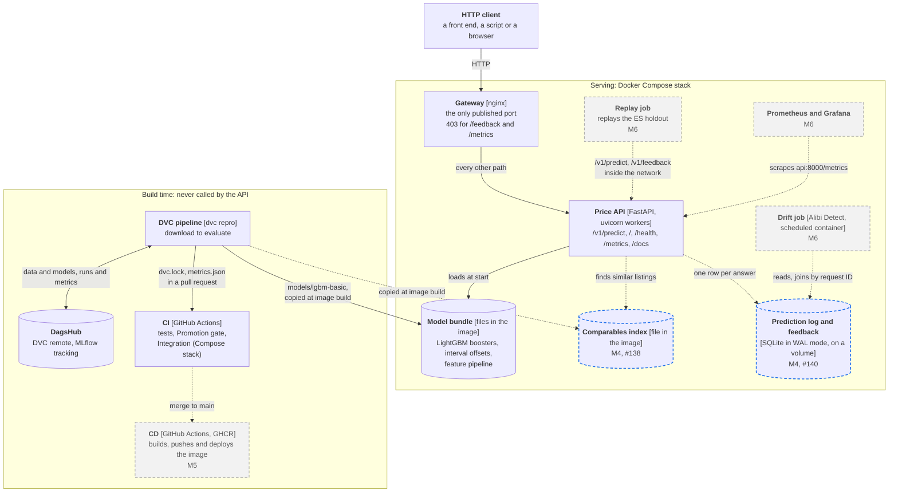
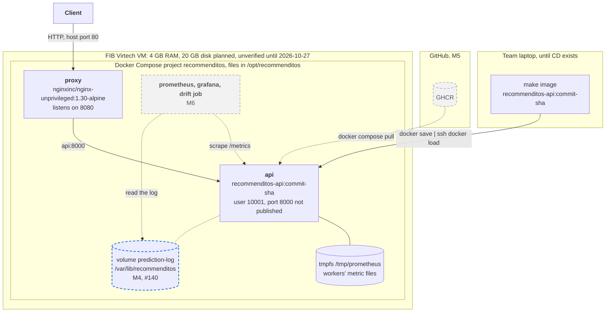

Architecture
============

This page shows how the price component is built in two views: the logical view, which containers there are and how they talk ([C4](https://c4model.com/) container level), and the physical view, where they run.
It then names the architectural patterns, what the design leaves out, and the decisions behind both, with their entries in the [Engineering Decision Notebook][edn] (EDN).
What each part must do is in the [specification](specification.md); how to run the API and the stack is in [The API](api.md) and [Deployment](deployment.md).

Every element is in one of three states, and the diagrams draw them differently:

| State | Drawn as | Meaning |
|-------|----------|---------|
| Built | solid | On `main` |
| M4, in progress | dashed, blue | Milestone 4 work with an open issue or pull request, named in the label |
| Planned | dashed, grey | Milestone 5 or 6, named in the label |

## Logical view: containers

| Container | Technology | Responsibility | State | Where |
|-----------|------------|----------------|-------|-------|
| Gateway | nginx 1.30, unprivileged | Publishes the stack's only port, forwards everything but `/feedback` and `/metrics`, which it answers with 403, sets the security headers and answers its own errors as RFC 9457 problems | Built | `deploy/nginx.conf` |
| Price API | FastAPI on uvicorn, started by `python -m recommenditos.api`; `WEB_CONCURRENCY` sets the workers | Validates a request, prices it with the bundle, explains the price (FR-08), and answers errors as RFC 9457 problems; client endpoints under `/v1`, operational ones at the root | Built: `/v1/predict`, `/`, `/health`, `/metrics`, `/docs`. M4: `/v1/price-range` (#139), `/v1/comparables` (#138), `/v1/feedback` (#140) | `recommenditos/api/` |
| Model bundle | The `train` stage's output directory, copied into the image | The boosters for UC1 and UC2, the interval offsets and the fitted feature pipeline; `/health` reports its hash from `dvc.lock` (FR-12) | Built | `Dockerfile`, `recommenditos/modeling/model.py` |
| Comparables index | Built by the pipeline, copied into the image | The training and validation listings `/v1/comparables` searches (FR-09) | M4, #138 | - |
| Prediction log and feedback | SQLite in WAL mode on a named volume, behind a store interface | One row per answer (FR-13) and one per observed price (FR-10), joined by request ID (FR-14) | M4, #140 | - |
| Replay job | A container in the stack | Sends the `ES` holdout as requests and its prices as feedback, the new-market scenario (NFR-11) | M6 | - |
| Drift job | Alibi Detect in its own scheduled container (NFR-04) | Input drift, error and interval coverage per window of logged requests (FR-14, EDN-14) | M6 | - |
| Prometheus and Grafana | Containers in the stack | Scrape `/metrics` inside the network and show latency, errors and resources | M6 | - |
| DVC pipeline | DVC stages, one module each, parameters in `params.yaml` | Turns the raw listings into the model bundle, its metrics and the gate's verdict | Built | `dvc.yaml`, [The DVC pipeline](pipeline.md) |
| DagsHub | DVC remote and hosted MLflow | Stores data and models; records every run and which one was promoted | Built | [Data versioning](data-versioning.md) |
| CI | GitHub Actions | On every pull request: lint, tests on Linux and Windows, the serving-runtime check, the Promotion gate, the stack's integration tests through nginx | Built | `.github/workflows/ci.yml` |
| CD | GitHub Actions and GHCR | On a merge to `main`: builds and pushes the image, deploys it over SSH and runs the smoke check (NFR-13) | M5 | [What M5 adds](deployment.md#what-m5-adds) |

The API reads nothing at request time that the image does not hold: no call to DagsHub, MLflow or another service sits on the path of a request.
The only state it writes is the prediction log, so a worker or the whole container can be restarted or replaced without losing a request's context.

## Physical view: deployment

- **The VM.** One FIB Virtech VM for the semester ([EDN-17][edn]); we get access at the lab on 2026-10-27, so its size, operating system and reachable ports are unverified until then, and the [lab checklist](deployment.md#lab-checklist) is how we find out.
  The 4 GB of RAM and 20 GB of disk are what the course announced and what NFR-04 budgets for.
- **The stack.** Docker Compose runs two containers today: `proxy`, the only one with a published port, and `api`, reachable only inside the Compose network ([EDN-87][edn]).
  The host port is `HTTP_PORT` in the stack's `.env`: 80 on the VM, 8080 on a laptop, where `make stack` runs the same stack.
  Both containers restart after a crash and after a reboot, and `proxy` starts once the API's health check passes (NFR-05).
- **Storage.** The API's metric files live in a tmpfs owned by the service user; the prediction log will live on the named volume `prediction-log`, so it survives a new image and the drift job can mount it (#140).
  Everything else in the API container is the image.
- **How the image gets there.** Until CD exists, a laptop builds the image at the commit to deploy and streams it with `docker save | ssh docker load`, so the VM needs neither the repository, DVC nor a DagsHub token ([Deployment](deployment.md#how-the-image-gets-there)).
  In M5, CD builds the same image in GitHub Actions and the VM pulls it from GHCR; rolling back is starting the previous tag.

## Patterns

| Pattern | Where | Why | Decision |
|---------|-------|-----|----------|
| Model as a service behind a stateless API | Price API | Clients depend on the HTTP contract only, so a model can be swapped by a merge without changing them, and any worker can answer any request | FR-12, [EDN-08][edn] |
| Model baked into the image at build time | `Dockerfile` copies `models/lgbm-basic` | The image that was tested is the one that runs, startup needs no network, and a rollback is the previous tag | [EDN-08][edn] |
| Reverse proxy as gateway | nginx in front of the API | One published port; nginx refuses `/feedback` and `/metrics` at the edge, so only services inside the Compose network reach them | FR-10, [EDN-13][edn], [EDN-87][edn] |
| Prediction log with a delayed-label feedback loop | API, store, replay and drift jobs | Prices are observed after the answer, so the real error and the interval coverage can only be computed by joining the observed price to the logged answer by request ID | FR-13, FR-10, FR-14 |
| Store interface | `PredictionStore` in front of SQLite | The API and the drift job see a small interface, so moving to PostgreSQL is a local change if the system ever runs on more than one host | [EDN-86][edn] |
| One endpoint per use case | `/v1/predict` (UC1), `/v1/price-range` (UC2) | The two use cases require different fields and return different answers, so each gets its own schema, validation and documentation | [EDN-15][edn] |
| Versioned client contract | `/v1` routers; `/`, `/health`, `/metrics` at the root | An incompatible change can ship as `/v2` beside `/v1`; monitors and Prometheus find the operational endpoints where they look for them | - |
| Training-only libraries kept out of serving | `[project] dependencies` against dependency groups | MLflow, `shap` and MAPIE stay out of the image, which keeps it under NFR-04's 1 GB (665 MB measured for EDN-87); `make test-serving` fails on a serving import from a group | [EDN-47][edn], [EDN-11][edn], [EDN-85][edn] |
| Promotion as a gated merge | Required CI check `Promotion gate` | A pull request that changes `dvc.lock` fails unless its committed verdict passes NFR-01's gate, so promoting a model is a reviewed merge; the SC-04 waiver for `lgbm-basic` is versioned in `params.yaml` | [EDN-12][edn], [EDN-62][edn], [EDN-06][edn] |
| Health-checked containers with a restart policy | Image `HEALTHCHECK`, `restart: unless-stopped` | A crashed API is back within NFR-05's 30 s, and nginx answers 503 meanwhile; a hung but living API is only marked unhealthy until M5 | [EDN-10][edn] |

## What the design leaves out

Each of these would add a moving part that no requirement needs yet:

- **A container orchestrator.** The system runs on one VM ([EDN-17][edn]), where Docker Compose restarts and connects the containers ([EDN-87][edn]).
- **A model registry at run time.** The API never asks MLflow for a model; startup would then depend on DagsHub being reachable ([EDN-08][edn]).
- **A database server.** One SQLite file serves the workers and the drift job on one host; PostgreSQL would cost a container, a secret and memory on the 4 GB VM ([EDN-86][edn]).
- **TLS and an automatic-TLS proxy.** Every publicly reachable endpoint is read-only and carries no secret, so NFR-09 needs no TLS, and Caddy's or Traefik's automatic certificates would bring nothing nginx lacks ([EDN-13][edn], [EDN-87][edn]).

## Decisions

The entries in the [EDN][edn] that shape this architecture:

| EDN | Decision |
|-----|----------|
| EDN-06 | A model is deployable only when it meets the success criteria |
| EDN-08 | The model is baked into the API image; promoting a model is a merge to `main` |
| EDN-10 | The availability target is recovery within 30 seconds |
| EDN-11 | Serving explains predictions without the `shap` package |
| EDN-12 | Retraining and promotion are started by a person, and a failing gate blocks the merge |
| EDN-13 | The feedback endpoint is reachable only inside the Compose network |
| EDN-14 | Drift is tested on windows of 1,000 requests at level 0.005 |
| EDN-15 | `/predict` requires ten fields; UC2 has its own endpoint (absorbs EDN-16) |
| EDN-17 | The component is deployed on the FIB Virtech VM |
| EDN-28 | The pipeline code is one module per DVC stage |
| EDN-47 | The serving runtime is separated by dependency groups |
| EDN-55 | Each model variant has one MLflow run across stages |
| EDN-62 | `lgbm-basic` is the candidate model, with the gate's SC-04 waiver |
| EDN-84 | Every API error is an RFC 9457 Problem Details object |
| EDN-85 | Serving adds MAPIE's offsets itself |
| EDN-86 | The prediction log and the feedback are stored in one SQLite file in WAL mode (#140) |
| EDN-87 | The API runs on the VM as a Compose stack behind nginx from Milestone 4 |

[edn]: https://github.com/mlops-2627q1-mds-upc/MLOPS_Recommenditos/blob/main/reports/edn.md
