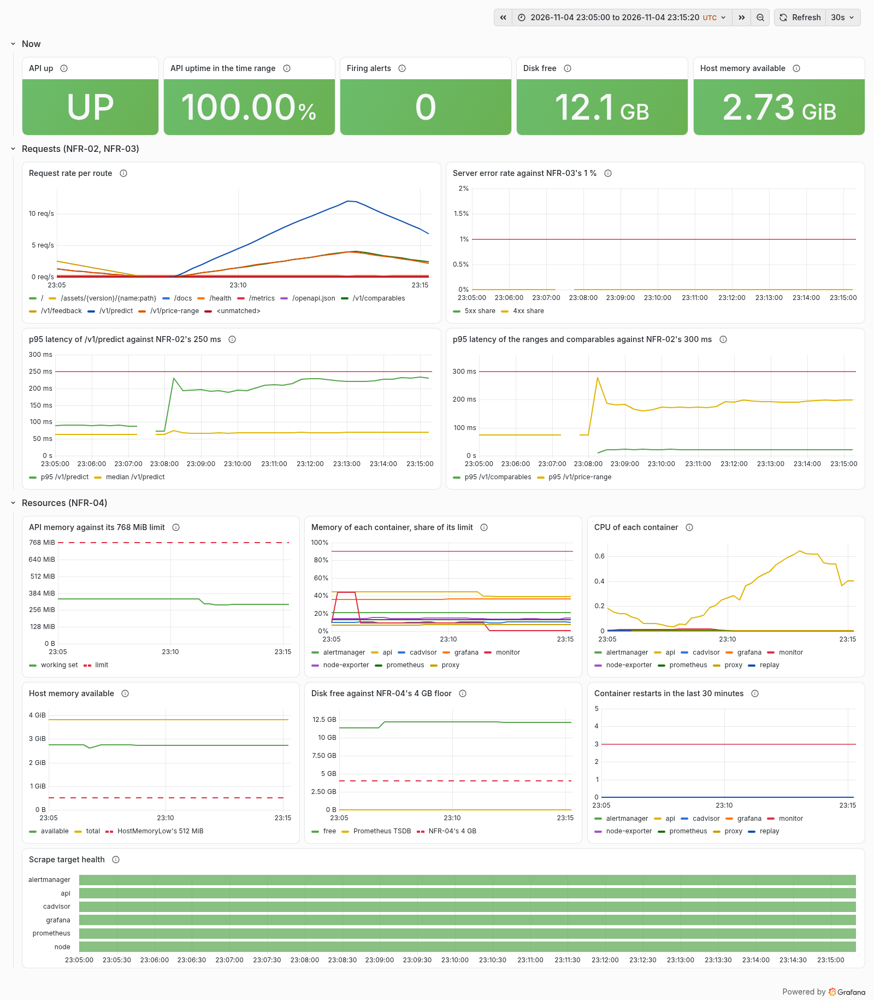
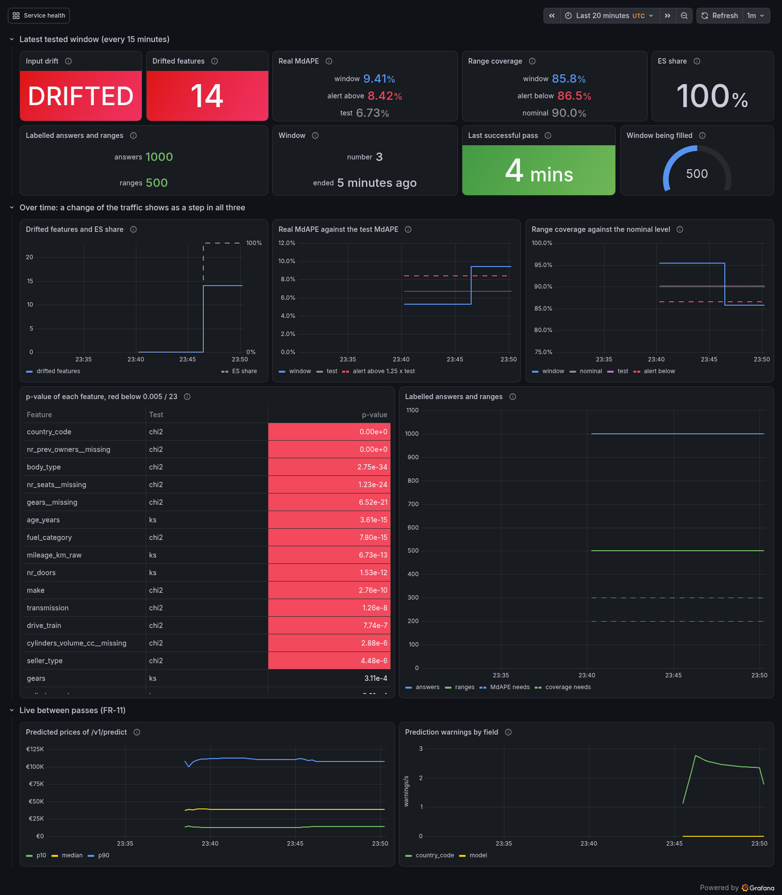

Monitoring
==========

Milestone 6 watches the running system from three sides.
Better Stack checks the public `/health` from outside, so it notices when the VM itself is gone ([External uptime check](deployment.md#external-uptime-check)).
Prometheus, inside the stack, keeps the figures of the API and of the machine it runs on ([Resource monitoring](#resource-monitoring)).
The [drift job](#drift-job) compares what the API is asked with what the model was trained on.
With no real users, its traffic is the [replay](#replay) of held-out listings.
[Grafana](#grafana) shows Prometheus' figures against the limits the requirements set, and [alerts](#alerts) post to the team's Discord before a limit is reached, each with what to do ([#225](https://github.com/mlops-2627q1-mds-upc/MLOPS_Recommenditos/issues/225)).
Its second dashboard, [Model performance](#model-performance), shows the drift job's findings over time, and the [model alerts](#model-alerts) post them, each a reason to start the retraining of FR-15 ([#230](https://github.com/mlops-2627q1-mds-upc/MLOPS_Recommenditos/issues/230)).

## Resource monitoring

Three services of `deploy/compose.yaml` run beside the API and nginx, on a laptop, in CI and on the VM alike ([EDN-99](https://github.com/mlops-2627q1-mds-upc/MLOPS_Recommenditos/blob/main/reports/edn.md), [#224](https://github.com/mlops-2627q1-mds-upc/MLOPS_Recommenditos/issues/224)):

| Service | What it reports | Memory limit |
|---------|-----------------|--------------|
| `prometheus` | Scrapes the four targets below every 15 s and stores the samples; its own figures too (TSDB size, failed scrapes) | 384 MiB |
| `cadvisor` | Per container: CPU, memory against the container's limit, the start time and block I/O | 192 MiB |
| `node-exporter` | The host: memory, CPU, load, and the free bytes of each file system, the root's among them | 64 MiB |

Prometheus scrapes, by Compose service name and inside the Compose network:

| Job | Target | Why |
|-----|--------|-----|
| `api` | `api:8000/metrics` | Requests, latency and errors per route, the predicted prices, the warnings and the served model (FR-11, [API docs](api.md#metrics)); one target whatever the number of workers, since in multiprocess mode any worker answers with the sum of all |
| `cadvisor` | `cadvisor:8080` | What the API cannot see of itself: its container's memory and CPU, and its restarts |
| `node` | `node-exporter:9100` | Whether the VM runs out of memory or disk (NFR-04) |
| `prometheus` | `localhost:9090` | Whether Prometheus itself keeps up and how much disk its TSDB takes |

The configuration is [`deploy/prometheus/prometheus.yml`](https://github.com/mlops-2627q1-mds-upc/MLOPS_Recommenditos/blob/main/deploy/prometheus/prometheus.yml), mounted read-only, and it travels with every release like the other stack files ([The stack files on the VM](deployment.md#the-stack-files-on-the-vm)).
`make prometheus-check` runs `promtool check config` on it with the stack's own Prometheus image, and CI's integration job runs it before it starts the stack.

### The questions it answers

Each figure answers a question someone on call would ask, and the integration suite checks that each one reaches Prometheus with a value (`tests/integration/test_deployed_prometheus.py`):

| Question | PromQL |
|----------|--------|
| How close is the API to its memory limit? | `container_memory_working_set_bytes{container_label_com_docker_compose_service="api"} / container_spec_memory_limit_bytes{container_label_com_docker_compose_service="api"}` |
| Did a container restart, after a crash, an out-of-memory kill of its main process or a hang (EDN-93)? | `changes(container_start_time_seconds{container_label_com_docker_compose_service="api"}[1h])` |
| How busy is the one vCPU, per container? | `rate(container_cpu_usage_seconds_total{container_label_com_docker_compose_service!=""}[5m])` |
| How much memory is left on the host? | `node_memory_MemAvailable_bytes` |
| How far is the disk from NFR-04's 4 GB floor? | `node_filesystem_avail_bytes{mountpoint="/"}` |
| How much disk does Prometheus take? | `prometheus_tsdb_storage_blocks_bytes + prometheus_tsdb_wal_storage_size_bytes` |

cAdvisor names a container's series by its Compose service and project, the labels `container_label_com_docker_compose_service` and `container_label_com_docker_compose_project`, and by no other label of the image, so that the series stay few.
It is started with `--docker_only`, so it reports Docker's containers and the host's root cgroup and none of the host's other cgroups.
It reads the cgroups every 30 s (`--housekeeping_interval`), which keeps its own CPU low on the VM's one vCPU, and up to 60 s when a container's figures do not change (dynamic housekeeping), so a container's figures are up to 60 s old, and right after a restart they can still show the container as it started.

What the stack does not show:

- **Out-of-memory kills of a worker.** cAdvisor's OOM events read the kernel log from `/dev/kmsg`, which it is not given; a kill of the API's main process shows as a restart, and a kill of one of several workers only as memory at the limit and in the API's log.
- **Network traffic, per container or of the host.** The request traffic comes from the API's own metrics (`http_requests_total` and its latency histogram, [API docs](api.md#metrics)).
  Per-container network bytes are left out on purpose: cAdvisor reads them from the host's `/proc`, which it would need under `/rootfs` with `/var/lib/docker`, widening its root exception for no requirement.
  node-exporter does not use the host's network, so its network figures are those of its own container.
- **The CI runner.** The self-hosted runner is a process on the host, not a container: it shows in the host's memory and CPU, not per container.

### Retention

Prometheus keeps at most 2 GB or 60 days of samples, whichever it reaches first, and drops the oldest block first (`--storage.tsdb.retention.size=2GB`, `--storage.tsdb.retention.time=60d`, NFR-04).
Prometheus reads the units of a size as powers of two, so the cap is 2 GiB, 2.15 GB of the VM's 20 GB disk; the size counts the TSDB's blocks and its write-ahead log.
Sixty days are the rest of the term with room to spare.
The TSDB lives in the named volume `prometheus-data`, so it survives a new image, a changed configuration and a rollback; `docker compose down` keeps it, and only `down -v` removes it.
The integration suite checks both flags and the volume, as NFR-04's "a deployment check that the retention caps are configured, not just intended" asks.

### The textfile collector

node-exporter also exports every `*.prom` file in `/var/lib/node-exporter/textfile` of its container, which is the named volume `monitor-textfile`, mounted read-only there.
That is how a job that is not a server publishes figures: the [drift job](#drift-job) mounts the same volume writable and writes `monitor.prom` there after every pass, without a port or a push gateway of its own.
It writes the file under a temporary name and renames it, so that a scrape never reads half a file, and leaves it readable to all, because node-exporter runs as `nobody`.
The volume is a tmpfs that Docker mounts with the job's user, 10001, as its owner: a volume on disk would be root's when node-exporter, which runs as `nobody` from an image without that directory, mounted it first, and the job could not write it.
A reboot empties it until the next pass, and the volume `node-textfile` of the first stacks is no longer used.

### Reachable only inside the stack

None of the three publishes a port: the VM's ports 8080 to 8089 are public through the NAT ([The VM](deployment.md#the-vm)), and nothing but nginx is meant to be (NFR-09).
The integration suite checks that no service but the proxy publishes one beyond the host's loopback, and that none uses the host's network, which would open its ports on the host without a `ports` entry.
[Grafana](#grafana) is the way in, through an SSH tunnel to the VM.
For a figure the dashboard does not show, Prometheus' HTTP API is reached from inside its container, whose busybox `wget` asks it on `127.0.0.1:9090`:

```bash
# Locally, after make stack:
docker exec recommenditos-prometheus-1 \
  wget -qO- 'http://127.0.0.1:9090/api/v1/targets?state=active'
docker exec recommenditos-prometheus-1 \
  wget -qO- 'http://127.0.0.1:9090/api/v1/query?query=node_filesystem_avail_bytes'

# On the VM, from /opt/recommenditos, with the paths deploy.sh uses:
docker compose -f "$(readlink -f stack)/compose.yaml" --env-file .env exec prometheus \
  wget -qO- 'http://127.0.0.1:9090/api/v1/targets?state=active'
```

For Prometheus' own web page during debugging, a temporary tunnel reaches the container's address on the VM's Docker network without publishing anything, with UPClink connected ([Open it](#open-it)):

```bash
ip=$(ssh -p 22052 recommenditos@nattech.fib.upc.edu \
  docker inspect -f '{{range .NetworkSettings.Networks}}{{.IPAddress}}{{end}}' recommenditos-prometheus-1)
ssh -p 22052 -N -L 9090:"$ip":9090 recommenditos@nattech.fib.upc.edu   # then open http://localhost:9090
```

The address changes when the container is recreated, so look it up again after a deploy.

### Hardening, and cAdvisor's exception

All three run with the shared hardening of the stack: a read-only root file system, no Linux capability, `no-new-privileges`, and limits on memory and processes ([The stack](deployment.md#the-stack)).
Prometheus and node-exporter run as `nobody`.
cAdvisor runs as root, because it reads the Docker socket and `/var/lib/docker`, which only root can.
The Docker socket is root-equivalent on the host, however read-only its mount is: whoever can talk to it can start a privileged container.
That is the price of per-container figures, and it is kept small: cAdvisor drops every capability, mounts the socket, `/sys` and `/var/lib/docker` read-only and nothing else of the host, publishes no port, and serves only its metrics and its read-only web page to the Compose network.
The integration suite names cAdvisor as the one service that runs as root and checks that every host path it mounts is read-only.
node-exporter reads the host's `/` under `/host`, read-only too, and needs neither the host's network nor its PID namespace for the figures above.

cAdvisor reads the containers' cgroups, which are cgroup v2 on CI's runners and current laptops, and cgroup v1 on the VM (Ubuntu 20.04).
The figures above have the same names under both.

### When a monitoring service does not start

The monitoring services, Grafana and Alertmanager below included, are part of the release, so a deploy waits for them as for the API: `deploy.sh` runs `docker compose up --wait`, and a monitoring service that does not become healthy fails the deploy, which then puts the previous release back, the API included ([Every deploy](deployment.md#every-deploy)).
That is wanted for a broken configuration, which `make prometheus-check` and CI's integration job should catch first, and unwanted for a registry that cannot be reached: the images come from quay.io, ghcr.io and, for Grafana, Docker Hub, whose anonymous pull limit counts per address and the FIB's NAT is shared; a VM that cannot pull one keeps the release that runs.
A deploy pulls an image only when its digest in `compose.yaml` changed.
Their healthchecks therefore probe only that each serves (`/-/ready`, `/healthz`, the landing page, Grafana's `/api/health`), not what it scrapes, so a failing scrape target never fails a deploy.
Each also restarts on its own after a crash and after a reboot (`restart: unless-stopped`, NFR-05).

## Grafana

Grafana runs in the stack and shows two provisioned dashboards, linked to each other at the top right: **Service health**, which is also its home page, and [Model performance](#model-performance).
Service health shows the figures of [Resource monitoring](#resource-monitoring) against the limits the requirements set ([EDN-99](https://github.com/mlops-2627q1-mds-upc/MLOPS_Recommenditos/blob/main/reports/edn.md), [#225](https://github.com/mlops-2627q1-mds-upc/MLOPS_Recommenditos/issues/225)).

| Panel | Against | Alert |
|-------|---------|-------|
| API up, scrape target health | NFR-05: back within 30 s | [ApiDown](#apidown), [TargetDown](#targetdown) |
| API uptime in the time range | NFR-05: monitored and reported | - |
| Firing alerts | - | all of [Alerts](#alerts) |
| Request rate per route | FR-11 | - |
| p95 latency of `/v1/predict` | NFR-02: 250 ms ([EDN-88](https://github.com/mlops-2627q1-mds-upc/MLOPS_Recommenditos/blob/main/reports/edn.md)) | [PredictLatencyHigh](#predictlatencyhigh-and-rangelatencyhigh) |
| p95 latency of `/v1/price-range` and `/v1/comparables` | NFR-02: 300 ms | [RangeLatencyHigh](#predictlatencyhigh-and-rangelatencyhigh) |
| Server error rate | NFR-03: 1 % | [ErrorRateHigh](#errorratehigh), [ServerErrors](#servererrors) |
| API memory | its 768 MiB limit (NFR-04 caps it at 1 GB) | [ContainerMemoryNearLimit](#containermemorynearlimit) |
| Memory of each container, share of its limit | 90 % | [ContainerMemoryNearLimit](#containermemorynearlimit) |
| CPU of each container | the VM's one vCPU | - |
| Host memory available | 512 MiB | [HostMemoryLow](#hostmemorylow) |
| Disk free | NFR-04: 4 GB | [DiskFreeLow](#diskfreelow) |
| Container restarts in the last 30 minutes | 3 | [ContainerRestarting](#containerrestarting) |

Every target and limit is drawn in red and dashed, as a threshold line or, for the API's memory limit and the host's memory and disk floors, as a dashed series, so that none is mistaken for data or for a gridline, in colour or in greyscale.
Each service has one fixed colour on every panel that draws one line per container (memory, CPU, restarts), of mid lightness so that it reads on Grafana's dark theme, which production opens in, and on the light one; `tests/test_monitoring_config.py` fails when a service lacks its colour, two services share one, or a colour has less than 3:1 contrast against either background, so a new service in `deploy/compose.yaml` gets a colour in the same pull request.
The uptime panel is the share of Prometheus' scrapes of the API that succeeded in the dashboard's time range, seen from inside the stack.
It cannot see the VM or its network being gone; the uptime NFR-05 reports is Better Stack's, from outside ([External uptime check](deployment.md#external-uptime-check), EDN-10).



The screenshot is the VM's dashboard from 23:05 to 23:15 UTC on 2026-11-04, with NFR-03's load test running from 23:08 to 23:13 ([Load testing](load-testing.md)); the stat tiles show the values at the end of the range.
The gap just before 23:08 is the deploy that recreated the API 71 s before the load began.

### Provisioned, not clicked

Everything Grafana shows comes from `deploy/grafana/`, which travels with every release like the other stack files:

| File | What it provisions |
|------|--------------------|
| `provisioning/datasources/prometheus.yml` | The data source `Prometheus`, uid `prometheus`, at `http://prometheus:9090`, not editable |
| `provisioning/dashboards/dashboards.yml` | The dashboards in `dashboards/`, which the UI can neither save over (`allowUiUpdates: false`) nor delete |
| `dashboards/service-health.json` | The dashboard Service health, uid `service-health` |
| `dashboards/model-performance.json` | The dashboard [Model performance](#model-performance), uid `model-performance` |

A change to a panel is a change to the JSON file, reviewed in a pull request: change it in a local Grafana, copy the JSON (**Export**, **Export as JSON**), and remove the ids Grafana adds, the dashboard's `id`, `version` and `iteration`.
`tests/test_monitoring_config.py` fails on such ids, on repeated panel ids and on a panel that queries another data source, and checks that every alert links a panel that exists.
Panel ids stay what they are, since the alerts link panels by id.
Grafana reads the folder again every minute, so a new release's dashboard shows without a restart.
The integration suite checks that a fresh stack has the data source, reaches Prometheus through it, shows every dashboard with all its panels to an anonymous visitor, and that Prometheus accepts the query of every panel (`tests/integration/test_deployed_grafana.py`).

### Open it

Grafana listens on the host's `127.0.0.1:3000` only, on a laptop and on the VM alike, so no other machine reaches it; on the VM it is opened through an SSH tunnel:

```bash
ssh -p 22052 -N -L 3000:127.0.0.1:3000 recommenditos@nattech.fib.upc.edu
# then open http://localhost:3000 in the browser
```

The tunnel needs UPClink connected, on campus too: from the university's Wi-Fi (eduroam) the SSH port timed out on 2026-11-04 ([The VM](deployment.md#the-vm)).
The links in the alerts' messages point at `http://localhost:3000`, so they open once the tunnel is up.

Inside the tunnel, a visitor is an anonymous Viewer: every dashboard can be seen, nothing can be changed.
The admin logs in as `admin` with `GRAFANA_ADMIN_PASSWORD` from the stack's `.env`; compose.yaml has no default for it and refuses to start without one.
Grafana sets the password when it creates its database, in the named volume `grafana-data`, on its first start; a later change to `.env` does not change it, `docker exec recommenditos-grafana-1 grafana cli admin reset-admin-password <new>` does.
The rejected alternatives, Grafana read-only behind nginx's public port and screenshots only, are in [EDN-99](https://github.com/mlops-2627q1-mds-upc/MLOPS_Recommenditos/blob/main/reports/edn.md).

Grafana runs with the shared hardening (read-only root, no capability, `no-new-privileges`, its own user 472), with its database in the volume and a tmpfs on `/tmp`.
It sends nothing out: usage reports, update checks, the news feed, avatars and plugin downloads at start-up are off, and so is its own alerting, since the alerts are Prometheus' ([Alerts](#alerts)).
The data sources the image bundles besides Prometheus are turned off: each would run as a process of its own, and together they exhausted the container's 128 processes.

## Model performance

The dashboard **Model performance** (uid `model-performance`) shows what the [drift job](#drift-job) found in the latest window of 1,000 requests it tested: whether the inputs drifted, how large the real error is, and whether the price ranges hold their confidence level (FR-14, NFR-11, [#230](https://github.com/mlops-2627q1-mds-upc/MLOPS_Recommenditos/issues/230)).
The job writes its results into node-exporter's [textfile collector](#the-textfile-collector) after every pass, every 15 minutes, and Prometheus keeps them over time ([EDN-101](https://github.com/mlops-2627q1-mds-upc/MLOPS_Recommenditos/blob/main/reports/edn.md)).

| Panel | What it shows | Alert |
|-------|---------------|-------|
| Input drift, Drifted features | Whether any of the 23 features is below p 0.005 / 23, and how many are | [DriftDetected](#driftdetected) |
| Real MdAPE | The window's MdAPE over its labelled answers, the alert's ceiling and the test MdAPE | [ModelErrorHigh](#modelerrorhigh) |
| Range coverage | The share of the window's labelled ranges that hold the observed price, the alert's floor and the nominal level | [ModelCoverageLow](#modelcoveragelow) |
| ES share | The window's share of `ES` listings, the market the model was not trained on | - |
| Labelled answers and ranges | The window's answers and ranges with an observed price, red below the 200 and 300 a figure needs | - |
| Window | Its number in `monitor.db` and when its last request was answered | - |
| Last successful pass | How long ago a pass of the job last succeeded, red after 45 minutes | [MonitorStale](#monitorstale) |
| Window being filled | The requests of the open window, of 1,000 | - |
| Drifted features and ES share, Real MdAPE against the test MdAPE, Range coverage against the nominal level | The same figures over time, with the alert thresholds as dashed red lines | as above |
| p-value of each feature | The latest window's p-value per feature and test, sorted, red below 0.005 / 23 | [DriftDetected](#driftdetected) |
| Labelled answers and ranges over time | The counts against the 200 and 300 a figure needs; they grow while labels arrive | - |
| Predicted prices of `/v1/predict`, Prediction warnings by field | The live model outputs (FR-11, FR-05), moved here from Service health; the percentiles are drawn only where `/v1/predict` answered at least 30 requests in their 30 minutes, so they are empty in quiet traffic | - |

How to read it:

- **A step is a newly tested window.** The series hold the latest tested window's values until the next pass tests a newer one, so they change in steps, at most every 15 minutes.
  When the traffic changes from normal listings to `ES`, the pass that tests the first `ES` window moves all three at once: the drifted features from 0 to 14, the MdAPE from about 5.3 % to 9.4 %, and the coverage from about 95 % to 86 % ([the screenshot](#a-local-stand-in) below).
- **No value is not a good value.** A figure with fewer labelled answers than it needs is left out, so its stat shows "no value" and its line has a gap; the labelled counts say why.
- **The window figures are compared with the test set, not with the replay's control traffic.** The control listings are training listings, so their error is lower and their coverage higher than the test values ([The baseline](#the-baseline)).
- **Between passes**, the predicted-price percentiles and the warnings per field move with every request, so a shift of the inputs shows there before the next window is tested.
  In quiet traffic, as on the VM outside a replay, the percentiles have a gap until 30 requests lie in their 30 minutes: a percentile of fewer is the edge of one histogram bucket, which showed as all three lines at about 12,000 EUR.

Prometheus holds the latest window only: a pass that tests several windows, as after a replay, shows only the last of them, and Prometheus forgets everything after its 60 days of [retention](#retention).
A table of every window for the report comes from `report --all`, or `report --all --json` for every field, which read `monitor.db` ([How to read a finding](#how-to-read-a-finding)).

### A local stand-in



The screenshot is a local stand-in, taken on a laptop's stack on 2026-11-04 with the replay: 2,000 control listings and a pass, five minutes later 1,500 `ES` listings and a pass, at 15 to 19 listings a second.
DriftDetected, ModelErrorHigh, and ModelCoverageLow were firing and had reached Alertmanager when the screenshot was taken, four minutes after the pass.
The replay on the VM of the same evening shows the same step in the drift panel, but its error and coverage panels begin only after the replay, when the release that exports them was deployed; the windows of that replay are in [vm-es-replay-2026-11-04.md](https://github.com/mlops-2627q1-mds-upc/MLOPS_Recommenditos/blob/main/reports/monitoring/vm-es-replay-2026-11-04.md).

## Alerts

Prometheus evaluates the alerting rules in `deploy/prometheus/rules/` every 15 s and hands what fires to Alertmanager, which posts it to the team's Discord channel through a webhook ([EDN-99](https://github.com/mlops-2627q1-mds-upc/MLOPS_Recommenditos/blob/main/reports/edn.md)).
Each message carries the alert's summary, what to do, a link to its section below and a link to its dashboard panel through the [tunnel](#open-it).
Alertmanager groups the alerts by name, waits 30 s so that alerts firing together arrive in one message, posts again every 4 hours while a problem lasts, and posts when it is resolved.
While the API is down, its latency and error alerts are held back, and while ErrorRateHigh fires, so is ServerErrors.

| Alert | Fires when | For | Severity |
|-------|------------|-----|----------|
| [ApiDown](#apidown) | Prometheus cannot scrape `api:8000` | 1 minute | critical |
| [PredictLatencyHigh](#predictlatencyhigh-and-rangelatencyhigh) | more than 5 % of the `/v1/predict` answers of the last minute took over 250 ms, that is, the p95 is above NFR-02's target, with at least 20 answers in that minute | 5 minutes | warning |
| [RangeLatencyHigh](#predictlatencyhigh-and-rangelatencyhigh) | the same for `/v1/price-range` or `/v1/comparables` and 300 ms, per route | 5 minutes | warning |
| [ErrorRateHigh](#errorratehigh) | more than 1 % of the `/v1/` answers of the last minute are server errors (5xx), with at least 20 answers in that minute | 5 minutes | critical |
| [ServerErrors](#servererrors) | the API answered at least 5 `/v1/` requests with a server error in the last 15 minutes, at any traffic | at once | warning |
| [DiskFreeLow](#diskfreelow) | the host's root file system has less than 4 GB free | 5 minutes | critical |
| [HostMemoryLow](#hostmemorylow) | the host has less than 512 MiB available | 5 minutes | warning |
| [ContainerMemoryNearLimit](#containermemorynearlimit) | a container uses more than 90 % of its memory limit | 5 minutes | warning |
| [ContainerRestarting](#containerrestarting) | a container restarted 3 times in 30 minutes | at once | critical |
| [TargetDown](#targetdown) | a monitoring target other than the API cannot be scraped | 5 minutes | warning |

Why these thresholds:

- **Latency** is read from the histogram's 0.25 s and 0.3 s buckets, which are NFR-02's targets, so "more than 5 % slower than the target" is exact where an interpolated p95 is not; five minutes are as long as NFR-03's load test.
- **Errors** count server errors only: a 4xx is the API's correct answer to a bad request (FR-16), and the public internet sends many.
  The `/v1/` routes only, so that the healthcheck's `/health` every 5 s does not dilute the share; the dashboard shows the 4xx share beside it.
- **A one-minute share, for 5 minutes:** the share is taken over the last minute and must be above the target on every evaluation, every 15 s, for 5 minutes, so a breach fires only after it has lasted about 5 minutes; the rules' tests show a 6-minute breach at the replay's 5 requests per second firing 5 minutes 15 s after it began.
  A share over 5 minutes would stay above the target for 5 minutes after a spike of 30 s, so with `for: 5m` it would fire on that spike: at the replay's rate, any half minute of a busy vCPU (the drift job runs every 15 minutes) would post a firing and a resolved message to Discord.
  The tests show a one-minute spike of slow answers, and one of server errors, staying quiet.
- **At least 20 answers** in that minute, the rate of 100 in 5 minutes, so that one slow answer or one server error on a quiet day does not fire.
- **ServerErrors** has no such floor: outside the replay and the load tests the API gets almost no traffic ([EDN-13](https://github.com/mlops-2627q1-mds-upc/MLOPS_Recommenditos/blob/main/reports/edn.md)), and ErrorRateHigh would not see an API that fails every one of its 10 requests a minute.
  A healthy API answers no server errors at all, so five in 15 minutes are worth a look at any traffic; Prometheus' `increase` does not count the first answer of a status code the API has not given since it started, so it takes up to six.
- **Disk:** NFR-04's 4 GB floor is headroom, not the end of the disk, so the alert fires with room left to act.
- **Host memory:** the VM has no swap, so memory that runs out ends with the kernel killing a process; 512 MiB is the drift job's peak of up to 400 MiB per run with room to spare.
- **Restarts:** one restart is NFR-05 working (a crash, or a hang the healthcheck ends, EDN-93); three in half an hour are a loop.
  A deploy recreates a container, which counts as a new one, not as a restart.

The rules have unit tests, `deploy/prometheus/tests/service-health.test.yml`: for each alert, series that make it fire after its `for` duration with its labels and annotations, and series that must not.
`make prometheus-check` runs them with `promtool test rules`, after `promtool check config`, and checks Alertmanager's configuration with `amtool check-config`; CI's integration job runs it before it starts the stack.
The integration suite checks that Prometheus has loaded every rule and found Alertmanager, and that Alertmanager runs the Discord receiver.

### Model alerts

`deploy/prometheus/rules/model-performance.yml` alerts on the [drift job](#drift-job)'s findings, which it writes after every pass for the latest tested window ([Model performance](#model-performance)).
Each says what to do: look at the drifted features, check that the data and the observed prices are real, and start the Retrain workflow of FR-15, which a person starts ([Retraining on GitHub Actions](pipeline.md#retraining-on-github-actions)), with the finding of `report` as its reason.

| Alert | Fires when | For | Severity |
|-------|------------|-----|----------|
| [DriftDetected](#driftdetected) | a feature of the latest tested window is below p 0.005 / 23 (NFR-11) | at once | warning |
| [ModelErrorHigh](#modelerrorhigh) | the window's MdAPE is above 1 + 3.52 / sqrt(n) times the test MdAPE, n its labelled answers, at least 200 | at once | critical |
| [ModelCoverageLow](#modelcoveragelow) | the window's coverage is below the nominal level by more than 2.576 binomial standard errors and 0.5 / n, n its labelled ranges, at least 300 | at once | critical |
| [MonitorStale](#monitorstale) | no pass of the job has succeeded for 45 minutes, or none has written its figures | 5 minutes, within the 45 | warning |

The rules file records the ceiling and the floor at the window's count, `recommenditos_performance:mdape_ceiling_multiple` and `recommenditos_performance:coverage_floor`, and the alerts and the panels of [Model performance](#model-performance) read those series, so a threshold has one source; `tests/test_monitoring_config.py` fails when a panel copies a constant of the rules instead.
The figures change only when a pass tests a newer window, so the first three need no `for`: a finding fires at the scrape after the pass that made it and resolves when a newer window no longer shows it.
MonitorStale is held back while node-exporter, which serves the job's figures, cannot be scraped (TargetDown), since that alone empties the series.
None of the other three makes another redundant: the drift alert names the features, the error and coverage alerts say that users get worse prices and ranges, and a drift without them is a change the model copes with.

#### Why these model thresholds

A window is a sample of about 1,000 requests, so even a window of exactly the test distribution has an MdAPE above the test value half of the time.
The error and coverage thresholds are therefore one-sided tests at 0.005 per window, the false-alarm level NFR-11 sets for drift ([EDN-14](https://github.com/mlops-2627q1-mds-upc/MLOPS_Recommenditos/blob/main/reports/edn.md)), measured in `reports/analysis/model_alert_thresholds.py`:

- **Coverage.** If a window's ranges hold the nominal level p (0.9), the share of its n labelled ranges that hold the price has the binomial standard error sqrt(p (1 - p) / n): 1.73 points at 300 ranges, 1.34 at 500 and 0.95 at 1,000.
  The alert fires below p less 2.576 of them and less the continuity correction 0.5 / n, so below 85.4 % at 300 ranges, 86.4 % at 500 and 87.5 % at 1,000.
  Its false-alarm rate is about 0.005 per window (exact binomial at p = 0.9: 0.0043 to 0.0069 for 300 to 1,000 ranges, mean 0.0054, which a share of whole ranges cannot make exact; 0.0053 to 0.0089 without the correction).
  Drawing windows from the test set's range outcomes puts their 0.5th percentile 0.6 to 0.8 points above these floors, because the test coverage of 90.6 % is 0.6 points above the nominal level.
  The rule takes n from the window itself, so the level holds at any count; a fixed margin taken at the minimum of 300 would hold it only at 300 and miss a loss of 4 points at 500.
  It compares with the nominal level, the promise the ranges make to users, not with the test coverage.
- **MdAPE.** The spread of a median has no closed form, so it comes from drawing 20,000 windows of n labelled answers from the test set's 20,258 errors of `lgbm-basic`, for n from 200, the fewest the job reports an MdAPE for, to 1,000.
  Their 99.5th percentile falls with n like 1 + c / sqrt(n); the alert takes c = 3.52, the smallest constant at or above the percentile at every n measured for the model before #303 (3.45 for the promoted one), so its ceiling is 1.25 times the test MdAPE at 200 labelled answers, 1.20 at 300, 1.16 at 500 and 1.11 at 1,000.
  For the promoted model the ceiling is 0.004 to 0.010 above the percentile, so the false-alarm rate is 0.0027 to 0.0040 per window; the least-squares constant, 3.39, would reach 0.0057.
  It compares with `test_mdape`, which a retrained model brings with it, and the constant is checked again with the script when the model's errors change shape.
- **Labels.** Both alerts require `labels_sufficient`, so a window with too few labels cannot fire.
  Labels can arrive for 7 days after a window closed and every pass recomputes the figures, so a window is tested several times while its count grows; each look has the level 0.005, the window as a whole somewhat more.
- **Drift** is NFR-11's own test, the Bonferroni threshold over 23 features; its level flags at most 1 in 200 windows of the training distribution, so one flagged window between quiet ones is a false alarm until the next window or the error and coverage alerts confirm it.
- **All three together.** Under an unchanged distribution a window raises at least one of DriftDetected, ModelErrorHigh and ModelCoverageLow with a probability of at most 1.7 % (0.005 + 0.005 + 0.0069).
  A pass tests at most one new window, every 15 minutes, so the job makes at most 96 checks a day, and a window that stays the latest is not tested again unless labels arrive; outside a replay, the VM fills windows far more slowly than that, so false alerts are expected rarely, near zero.
  A finding stays firing until a newer window is tested ([Silencing a known finding](#silencing-a-known-finding)).
- **Staleness:** the job runs every 15 minutes, so 45 minutes without a pass that succeeded are three missed passes; 40 minutes held for 5 make those 45, and the 5 minutes keep a fresh stack quiet until its first pass has written the series.

On the windows the laptop replay measured on 2026-11-04 ([the evidence](https://github.com/mlops-2627q1-mds-upc/MLOPS_Recommenditos/blob/main/reports/monitoring/laptop-es-replay-2026-11-04.md)), all three findings fire for the `ES` window and none for the control windows:

| Window | Drift | MdAPE | Coverage | DriftDetected | ModelErrorHigh | ModelCoverageLow |
|--------|-------|-------|----------|---------------|----------------|------------------|
| 1, control | none | 5.38 %, 0.80 x test | 96.8 % of 500 | quiet | quiet | quiet |
| 2, control | none | 5.28 %, 0.78 x test | 95.4 % of 500 | quiet | quiet | quiet |
| 3, `ES` | 14 features | 9.41 % of 1,000, 1.40 x test, ceiling 1.11 x | 85.8 % of 500, floor 86.4 % | fires | fires | fires |

`reports/analysis/model_alert_thresholds.py` applies the thresholds to these windows, and the rule tests use their values.
The coverage of the `ES` window is 0.6 points below its floor, so an `ES` window with fewer labelled ranges may not fire it (at 300 ranges the floor is 85.4 %); the drift alert covers that case.
The rules' tests replay these values, `deploy/prometheus/tests/model-performance.test.yml`, together with the edges of each threshold.

### The Discord webhook

The webhook URL is a secret, since whoever has it can post to the channel: it is `DISCORD_WEBHOOK_URL` in the stack's `.env` ([`.env.template`](https://github.com/mlops-2627q1-mds-upc/MLOPS_Recommenditos/blob/main/deploy/.env.template)), and compose.yaml has no default for it, so a stack without it does not start rather than drop every alert.
Alertmanager does not expand environment variables in its configuration, and reads the URL from a file (`webhook_url_file`): the service's entrypoint writes it to a tmpfs that only Alertmanager's user can read, and starts Alertmanager without it in its environment.
A Compose secret would keep it out of `docker inspect` too, but Compose does not mount one from the environment into a read-only container.

A local stack (`make stack`) and CI's get a webhook that goes nowhere, so a laptop's or a runner's alerts never reach the team; `make stack LOCAL_DISCORD_WEBHOOK_URL=<url>` sends them somewhere on purpose.
The receiver was tested on 2026-11-04: a local Alertmanager posted the test alert `DiscordReceiverTest` (about 18:15 UTC) to the team's channel, where it arrived.

### What the alerts do not cover

- **Prometheus or Alertmanager down.** Nothing then evaluates or sends the alerts, and nothing says so; the dashboard's target health shows it, and Better Stack still notices the API being gone ([External uptime check](deployment.md#external-uptime-check)).
- **The VM or its network down.** The same: Better Stack's check from outside sends its own email.
- **Slowness on a quiet API.** The latency alerts need 20 answers a minute, so outside the replay and the load tests a slow API stays unnoticed; ServerErrors covers only its errors.
- **Fewer than five server errors in 15 minutes**, and errors that nginx answers itself (a 502 or 503 when the API does not answer in time): the API's metrics count only the answers it gives, and ApiDown and Better Stack cover an API that gives none.
- **The model's drift, error and coverage** have their own alerts and limits ([Model alerts](#model-alerts)).

### Runbook

On the VM, the commands below run as `recommenditos` over SSH, from `/opt/recommenditos` ([Deploy to the VM](deployment.md#deploy-to-the-vm)).

#### ApiDown

The API has not answered Prometheus' scrape for a minute, so it did not recover within NFR-05's 30 s on its own.

1. `./deploy.sh status` and `docker ps -a`: is the container running, restarting or gone?
2. `docker logs --tail 100 recommenditos-api-1`: a traceback at start-up is a broken image or bundle; a kill is memory (the API memory panel).
3. If the last deploy brought it, `./deploy.sh rollback` starts the previous release.
4. If the container is up but does not answer, the healthcheck ends it within about 21 s (EDN-93); if that does not happen, `docker restart recommenditos-api-1`.

#### PredictLatencyHigh and RangeLatencyHigh

More than 5 % of a route's answers took longer than NFR-02's target for five minutes.

1. On the dashboard, the CPU panel: does another container (the drift job, cAdvisor) or the self-hosted runner take the one vCPU at the same time? A load test or the replay running is expected to cause it.
2. The request rate: a traffic peak beyond NFR-03's 20 requests per second is outside the promise.
3. If neither, compare with the last deploy: a slower model or image is rolled back with `./deploy.sh rollback`, and the regression gets an issue with the panel.

#### ErrorRateHigh

More than 1 % of the `/v1/` answers were server errors for five minutes.

1. `docker logs --since 10m recommenditos-api-1`: the failing requests, their status codes and request IDs, and the tracebacks.
2. A full disk or a locked prediction log shows in the disk panel and the log; free space ([DiskFreeLow](#diskfreelow)).
3. If the errors began with a deploy, `./deploy.sh rollback`.

#### ServerErrors

The API answered at least five `/v1/` requests with a server error (5xx) in the last 15 minutes, which a healthy API never does, at any traffic.
On a busy API that stays above NFR-03's 1 %, [ErrorRateHigh](#errorratehigh) follows and holds this warning back.

1. `docker logs --since 20m recommenditos-api-1`: the failing requests, their status codes, request IDs and tracebacks.
2. One client's requests, or every request? A single malformed body that the API fails on instead of answering 422 is a bug: open an issue with the request ID.
3. If the errors began with a deploy, `./deploy.sh rollback`.

#### DiskFreeLow

Less than NFR-04's 4 GB are free on the host's root file system.

1. `docker system df` and `sudo du -xh -d1 /var/lib/docker`: images, volumes or container logs?
2. Old image tags: `docker image prune -a` removes the images no container uses, the previous release's too, so keep the tag `.deploy-previous` names (`docker image ls`).
3. Prometheus' TSDB is capped at 2 GB and the prediction log is pruned to its own cap; if one of them is larger, that cap is broken: open an issue.

#### HostMemoryLow

The host has less than 512 MiB available, and the VM has no swap.

1. The panel of each container's memory: which one grew?
2. Is a load test, the replay or a CI job on the self-hosted runner running? Those end on their own.
3. A container that keeps growing without load leaks: `docker restart recommenditos-<service>-1`, and an issue with the panel.

#### ContainerMemoryNearLimit

A container uses more than 90 % of its memory limit, and the kernel will soon kill its largest process.

1. Steady growth without more traffic is a leak: restart the container (`docker restart recommenditos-<service>-1`) and open an issue with the panel.
2. Growth with the traffic means the limit in `deploy/compose.yaml` is too small for that load: raise it in a pull request, with the measurement.

#### ContainerRestarting

A container restarted three times in 30 minutes.

1. `docker logs --since 30m recommenditos-<service>-1`: what it logged before each restart.
2. The memory panel: at its limit, it is killed for memory ([ContainerMemoryNearLimit](#containermemorynearlimit)); for the API, a hang ends with the healthcheck's kill (EDN-93).
3. If the restarts began with a deploy, `./deploy.sh rollback`.

#### TargetDown

Prometheus could not scrape a monitoring target for five minutes, so its panels and the alerts built on it see nothing.

1. `docker ps -a` and `docker logs --tail 100 recommenditos-<service>-1` for the target's service (cAdvisor, node-exporter, Alertmanager, Grafana, Prometheus itself).
2. Each restarts on its own after a crash, so one that stays down needs its log read; a configuration it refuses fails `make prometheus-check` in CI first.

#### DriftDetected

A feature of the latest tested window is below p 0.005 / 23: its requests are unlikely to come from the training distribution (NFR-11).

1. The p-value table of [Model performance](#model-performance) names the drifted features; `report` in the monitor container prints the finding ([How to read a finding](#how-to-read-a-finding)).
2. `country_code` alone is a new market mix; several features besides it are a population the model has not seen.
3. Check that the data are real: a client's bug, a replay or a load test sends unusual inputs too (the `client` column of the log says who sent them).
4. A single flag between quiet windows can be a false alarm (the test's level allows 1 in 200 windows of the training distribution); wait for the next window unless the error or coverage alert fires as well.
5. If the drift lasts, or the error or the coverage suffers, start the Retrain workflow ([Retraining on GitHub Actions](pipeline.md#retraining-on-github-actions)) with the finding as its `reason` (FR-15).

#### ModelErrorHigh

The real MdAPE of the latest tested window, over at least 200 answers with an observed price, is above its ceiling, 1 + 3.52 / sqrt(n) times the test MdAPE for n labelled answers ([Why these model thresholds](#why-these-model-thresholds)).

1. The drift panels: which inputs changed in the same window?
2. Check the observed prices: feedback with a wrong price, or prices from another source, raises the MdAPE too (`report --window N --json` lists the window's figures).
3. If the inputs drifted and the prices are real, the model prices this population worse than its test set: start the Retrain workflow with the finding as its `reason` (FR-15).

#### ModelCoverageLow

Fewer of the latest tested window's labelled ranges hold the observed price than their nominal level allows by chance ([Why these model thresholds](#why-these-model-thresholds)).

1. The drift panels and the MdAPE: a coverage loss with drift and a higher error is a population the model has not seen; one without them can be a range model that no longer fits.
2. Check the observed prices, as for [ModelErrorHigh](#modelerrorhigh).
3. Start the Retrain workflow with the finding as its `reason` (FR-15); a retrain also recalibrates the ranges.

#### MonitorStale

No pass of the drift, error and coverage job has succeeded for 45 minutes, so the model panels and alerts show an old window, or none.

1. `docker ps -a`: is `recommenditos-monitor-1` running? It restarts on its own and has no healthcheck, so a deploy does not notice it failing.
2. `docker logs --since 1h recommenditos-monitor-1`: a pass that fails prints `the drift pass failed: ...`; a run by hand, `docker compose -f stack/compose.yaml --env-file .env exec monitor python -m recommenditos_monitoring run-once`, shows the error ([Run it by hand](#run-it-by-hand)).
3. A full disk or memory at the container's limit shows on Service health; a pass that fails since a deploy is rolled back with `./deploy.sh rollback`.

#### Silencing a known finding

DriftDetected, ModelErrorHigh and ModelCoverageLow describe the latest tested window and stay firing until a newer window is tested, so Alertmanager posts them again every 4 hours.
When the finding is known, such as the `ES` window of a replay, which drifts on purpose, and nobody starts a retraining for it, silence it rather than read it every 4 hours.
On the VM only a replay fills the next window soon: the job needs 1,000 newer eligible requests, and the load test's requests (`client` `loadtest`) do not count.

Alertmanager publishes no port, so `amtool` runs in its container:

```bash
docker exec recommenditos-alertmanager-1 amtool --alertmanager.url=http://127.0.0.1:9093 \
  silence add 'alertname=~"DriftDetected|ModelErrorHigh|ModelCoverageLow"' \
  --duration=7d --author=<your name> --comment="<the window and why it is known, e.g. the ES window of the replay of <date>>"
```

It prints the silence's ID.
`silence query` lists the active silences, `alert query --silenced` the alerts they hold back, and `silence expire <ID>` ends one early; each takes the same `docker exec ... amtool --alertmanager.url=http://127.0.0.1:9093` before it.
A silence lasts its `--duration` (or until `--end`), and survives a restart and a deploy, since Alertmanager keeps its silences in the `alertmanager-data` volume.
Silence only the window alerts: MonitorStale and the service alerts say something new when they fire.

The other way to clear a finding is to give the job a newer window: a short control replay ([Run it on the VM](#run-it-on-the-vm)) of 1,000 requests, then a pass, tests a window of the training distribution, and the three alerts resolve once it is the latest.

## Replay

M6 has no real users ([EDN-13](https://github.com/mlops-2627q1-mds-upc/MLOPS_Recommenditos/blob/main/reports/edn.md)), so the traffic that makes drift, error and coverage visible is a replay of held-out listings ([#227](https://github.com/mlops-2627q1-mds-upc/MLOPS_Recommenditos/issues/227), [EDN-100](https://github.com/mlops-2627q1-mds-upc/MLOPS_Recommenditos/blob/main/reports/edn.md)).
It sends listings to the running API as a client would, and reports each listing's real price to `/v1/feedback` (FR-10), so the prediction log holds the requests the drift job compares with the training data and the labels it computes the error and the coverage from (NFR-11, FR-14).

It is the service `replay` of `deploy/compose.yaml`, behind the profile `replay`, in the monitoring image (`monitoring/Dockerfile`), and it runs by hand, to its end.
`up`, and with it every deploy, neither starts it nor removes a running one.
The monitoring image is its own uv project, `monitoring/`, with numpy 1.26 and pandas 2, because the drift job's Alibi Detect needs them; the API image stays the serving runtime (NFR-04).

### What it sends

The listings come from the samples of the `monitoring_samples` stage, which CD bakes into the image ([The monitoring samples](pipeline.md#the-monitoring-samples)):

| Sample | Listings | What it is |
|--------|----------|------------|
| `control` | 20,000 | Listings of `train` outside the drift reference, drawn at random from the same rows, so a control window is i.i.d. with the reference and the drift job must not flag it |
| `es` | 2,266 | Every listing of the `ES` holdout the API accepts (EDN-03), the market the model never saw, which the drift job must flag |

`--control N` sends the first N control listings, and `--then es` sends the ES listings after them, so a dashboard shows a clean before and after; `--then-count N` stops after N of them.
The listings are in a random order, so any run of consecutive ones is a random sample of its set.
The model was fitted on the control listings, so their error and coverage are in-sample and optimistic: they show that the labels flow, not how good the model is.
The drift job compares the error and coverage of a window with the model's test values instead ([The baseline](#the-baseline), [#229](https://github.com/mlops-2627q1-mds-upc/MLOPS_Recommenditos/issues/229)).

Each listing is sent with the body its sample holds: the fields the listing has, and nothing for a value it lacks, so the log records what such a client sends (#191).
The listings alternate between `/v1/predict` and `/v1/price-range`, so both endpoints' panels move and a window gets about as many ranges as point estimates.
They go through nginx, `http://proxy:8080`, as a client's requests do, with `X-Client: replay`, which the log records as `client`.

`registration_date` is moved forward by the whole months from the samples' `reference_date`, 2025-11-08, to the send time.
The model computes ages on 2025-11-08 and the API on the day it answers, so a listing of the 2025 snapshot replayed a year later would otherwise look a year older, and every control window would be flagged on `age_years`.
A month is complete at 00:00 UTC on the 8th; the drift job computes the age of a logged request with the same rule, so the two shifts cancel to within four days, three in the year after 2025-11-08 (`drift_features.py`).

After each priced answer, the listing's observed price goes to `http://api:8000/v1/feedback` with the answer's `request_id` and `RECOMMENDITOS_API_KEY` from `.env` in `X-API-Key`, inside the Compose network, because nginx refuses the path from outside.
A feedback that fails is sent again, up to three times with a growing pause, because the same price again is answered 200 and changes nothing.
A valuation is sent again only when it surely reached no route: no connection, or a 502 or 503.
After a read timeout the API may have logged the answer, so it is counted and not sent again, and no listing is logged twice.
That is why `--timeout` is at most 50 s: after 60 s without the API's answer nginx answers 503 itself (its default `proxy_read_timeout`, mapped to 503 in `deploy/nginx.conf`), the API may still log that listing, and a 503 is sent again, so the replay's own read timeout has to come first.
A 401 from `/v1/feedback` stops the run, since no price could be stored with that key.

The listings go one at a time at `--rate` per second (5 by default), so 5,000 control listings take about 17 minutes and all 22,266 about 74 minutes; when the API answers more slowly, the rate drops, and the summary says so.

### Run it locally

From the repository root, with the samples, the model and the index:

```bash
uv run dvc pull monitoring_samples models/lgbm-basic data/processed/comparables.parquet
export RECOMMENDITOS_API_KEY=$(python3 -c 'import secrets; print(secrets.token_urlsafe(32))')
# The stack refuses to start without these two; locally, alerts go nowhere.
export GRAFANA_ADMIN_PASSWORD=$(python3 -c 'import secrets; print(secrets.token_urlsafe(24))')
export DISCORD_WEBHOOK_URL=http://127.0.0.1:9/discarded
docker compose -f deploy/compose.yaml up -d --build --wait
docker compose -f deploy/compose.yaml --profile replay build replay
docker compose -f deploy/compose.yaml --profile replay run --rm replay \
    --control 300 --then es --then-count 300 --rate 5
```

`run` starts the API and nginx first if they are not running, and waits for a healthy API.
The replay streams the samples a listing at a time and keeps only its counts: in the run in [The summary](#the-summary) its container peaked at 76 MB (`memory.peak`, page cache included) of its 256 MiB limit.

### Run it on the VM

Over SSH, with UPClink off campus, as `recommenditos`, from `/opt/recommenditos`, with the paths `deploy.sh` uses ([The stack files on the VM](deployment.md#the-stack-files-on-the-vm)).
`deploy.sh` pulls the monitoring image of every release beside the API image, so the image of the running tag is there; `.env` names its repository in `MONITORING_IMAGE`, as `.env.template` does.
A long run goes in the background, so a dropped SSH connection does not end it.
Its output goes into a file beside `.env` as it is written, because the next deploy's `up --remove-orphans` removes a replay container that has ended, and its logs with it, so the summary must not wait in `docker logs`:

```bash
ssh -p 22052 recommenditos@nattech.fib.upc.edu
cd /opt/recommenditos
docker compose -f "$(readlink -f stack)/compose.yaml" --env-file .env --profile replay \
    run -d --name replay replay --control 5000 --then es --rate 5
nohup docker logs -f replay > "replay-$(date -u +%Y-%m-%dT%H%M%SZ).log" 2>&1 &
tail -f replay-*.log           # the progress, and the summary at the end
docker rm replay               # once it has ended
```

The drift job's windows of 1,000 requests fill at the rate the replay is given; NFR-11's twenty control windows take the whole control sample.

### The summary

The run ends with one line per sample and a total: the listings sent, the valuations by answer and the feedback by answer, then the duration and the rate it reached.
It exits 0 when every listing was priced (200) and its price stored (201, or 200 for a repeat), and 1 otherwise; a 409 or 404 from `/v1/feedback` is counted there.
For example, the run of 300 and 300 listings above on a laptop on 2026-11-04:

```text
phase    sent  answered  feedback
control  300   200: 300  201: 300
es       300   200: 300  201: 300
total    600   200: 600  201: 600
duration 119.9 s, 5.01 listings/s (target 5)
result: ok
```

### What it leaves in the log

Every replayed answer is a row with `client = 'replay'` and `inputs_sent_only = 1`, which the drift job reads ([Reading the log](api.md#reading-the-log)), and each one with a price has its feedback, which `labelled_predictions` joins to it:

```sql
SELECT client, inputs_sent_only, endpoint, COUNT(*) FROM predictions GROUP BY 1, 2, 3;
SELECT json_extract(inputs, '$.country_code') AS country, COUNT(*)
FROM labelled_predictions GROUP BY 1;
```

## Drift job

The drift job ([#228](https://github.com/mlops-2627q1-mds-upc/MLOPS_Recommenditos/issues/228), [EDN-101](https://github.com/mlops-2627q1-mds-upc/MLOPS_Recommenditos/blob/main/reports/edn.md)) compares each window of 1,000 logged requests with the 10,000 training listings of the drift reference, and says which input features drifted (FR-14, NFR-11).
From the observed prices of the same window's requests it also computes how large the real error is and whether the price ranges still hold their confidence level ([#229](https://github.com/mlops-2627q1-mds-upc/MLOPS_Recommenditos/issues/229)), so a window shows all three things FR-14 asks for: which properties changed, the error, and the coverage.
It is the `monitor` service of the stack, in the monitoring image of the replay.

### What it compares

A window is 1,000 consecutive rows of the prediction log by `seq` that are answers of `/v1/predict` or `/v1/price-range`, with `inputs_sent_only = 1`, from no marked client or from the replay ([Reading the log](api.md#reading-the-log)), and with all ten fields FR-01 requires.
The load test, the smoke checks, the web page and the rows from before #191 are left out by `client` and `inputs_sent_only`; a range request with only some fields is left out by the last rule, because the reference has every required field.
A change of `model_version` closes the window being filled as `partial`, untested, so that every window belongs to one model.

Each request becomes the 23 features of `drift_features.py`, its age computed on `as_of_for(answered_at)`, the rule that cancels the replay's shift of `registration_date` ([What it sends](#what-it-sends)).
Each feature has an Alibi Detect detector of its own, fitted on `data/monitoring/reference.parquet`:

- the eight numeric features, `KSDrift` on their non-missing values, of the reference and of the window alike;
- the seven categorical features and the eight missing indicators, `ChiSquareDrift`, over the categories of the reference and of the window together, so a category the reference never saw counts.

A feature has drifted when its p-value is below 0.005 / 23, about 0.000217, and a window is flagged when any feature has (NFR-11, EDN-14).
`model` is not compared: its 349 levels leave well under one expected count per cell of a chi-square on 1,000 requests.
`TabularDrift`, which runs the same tests over a whole table, cannot leave out the missing values of one column alone, so the job runs one detector per feature and applies the Bonferroni correction itself, as the validated scipy check `reports/analysis/nfr11_check.py` did.
The indicators `age_years__missing`, `mileage_km_raw__missing` and `power_kw__missing` are `present` in every accepted request; `ChiSquareDrift` accepts such a one-category feature and gives it the p-value 1, so they stay in the 23 and the threshold is the validated one.

### Error and coverage

Drift says the data changed, not that the model got worse; the error and the coverage say that.
A window's labels are the observed prices in the log's `feedback` table (FR-10) of exactly its requests, joined through `request_id`, which `window_requests` keeps for every window; feedback of the load test or the web page in between is not counted.
From them, per window:

| Figure | What it is |
|--------|------------|
| `labelled` | The window's answers with an observed price, of both endpoints |
| `mdape` | median(\|observed - `price_eur`\| / observed) over the labelled answers; for a range request with every field `/v1/predict` needs, `price_eur` is the point model's (EDN-85), so both endpoints count the same estimate |
| `labelled_ranges` | The labelled answers of `/v1/price-range`, the only endpoint that returns a range |
| `coverage` | The share of labelled ranges with `lower_eur` <= observed <= `upper_eur` |
| `nominal_level` | The share the ranges promise: the mean `confidence_level` of the labelled ranges, 0.9 |

A figure needs enough labels to mean something: an MdAPE at least 200 labelled answers and a coverage at least 300 labelled ranges.
With fewer, its status is `insufficient_labels` and it has no value, in `monitor.db`, in the report and in Prometheus, so a quiet window, or one whose prices have not come in yet, is not read as a good one.
At a coverage of 0.9 the standard error over 300 ranges is 1.7 percentage points, and the coverage alert allows 2.576 of them and 0.5 / n below the nominal level ([Why these model thresholds](#why-these-model-thresholds)).
A window of the replay, which alternates the endpoints, has about 500 of each, so both figures exist once its prices are in.

Prices can come in after their window closed, so every pass recomputes the figures of every window that is not final, and a late price counts in the window of its request.
Seven days after a window's last answer its figures are marked final and no later price changes them.
The log's rotation deletes the oldest answers with their feedback ([Rotation](api.md#rotation)); once any of a window's requests is gone, a recount would rest on fewer labels, so the window keeps the figures it last had and is final from then on.
A rotation while a pass runs is caught too: the pass finds fewer labels than the figures it last stored had, and labels otherwise only grow.
A window that `monitor.db` held from before this table existed is counted once on what the log still has.

Every answer is one row of the log's one SQLite file whichever worker wrote it, and `feedback` holds at most one price per answer, so with several workers each answer counts once, and the read-only job sees every price committed before its pass read the log; one committed later counts in the next pass (NFR-03).

#### The baseline

The figures are compared with the model's values on the test set with every input given, since a window holds only requests with all ten required fields.
The MdAPE is the `evaluate` stage's test MdAPE in `metrics.json`, `variants.<model_variant>.mdape`, 6.80 % for `lgbm-basic`, which the stage measures on full inputs.
The coverage is that of the `full` scenario, pooled over makes, in the stage's `reports/metrics/interval-coverage-by-make.csv`, 90.6 % for `lgbm-basic`.
It is not `sc05_coverage`, 91.8 %, which is the coverage SC-05 judges for the partial-input scenario P1 (make, model, registration date, and mileage only), requests a window never holds.
Both files are committed with the stage's outputs, and the monitoring image copies them for the model of its release; a variant the table has no row for, one without a range model, gets no test coverage.
They are not compared with the replay's control listings: those are training listings, so their error and coverage are in-sample and optimistic, and they show only that the labels flow ([What it sends](#what-it-sends)).
A window of the training distribution therefore has a lower MdAPE than the test value and a coverage above it; a window the model prices worse than its test set has a higher MdAPE and a lower coverage.
`report` prints the ratio to the test MdAPE and the test coverage beside each figure, and the [model alerts](#model-alerts) fire on them.

A window is judged against the test values of the model that answered its requests, its `model_version`, not those of the model running when a pass scores it ([#307](https://github.com/mlops-2627q1-mds-upc/MLOPS_Recommenditos/issues/307)).
So a stored report keeps its ratios when it is re-read after a promotion, and `ModelErrorHigh` right after a promotion compares the old model's error with the old model's test MdAPE.
The image holds only its own release's evaluate outputs, so every pass first records them in `monitor.db`'s `model_test_values`, for the model version of each variant that the release's `dvc.lock` names: the hash of `models/<variant>` without `.dir`, which is the version the API reports in `/health` and logs with every answer (FR-12).
The first record of a version stays, so a later release that carries the same model, a rollback for example, changes no comparison.
That also keeps a wrong record: a release whose `metrics.json` was wrong, or an evaluation fix that leaves `models/<variant>` unchanged, does not replace the values already recorded for that version.
To correct one, deploy the release with the right values first, then delete the version's row; the next pass records the running image's values again, and every window that is not final is scored against them, while a final window keeps its figures.
Deleting the row while a release with the wrong values runs only records them again, and deleting the row of a version no release runs any more leaves its windows with the values they last had.
On the VM, from `/opt/recommenditos`, with the version from `/health`:

```bash
docker compose -f stack/compose.yaml --env-file .env exec -T monitor python -c '
import sqlite3, sys
db = sqlite3.connect("/var/lib/recommenditos-monitor/monitor.db")
with db:
    deleted = db.execute(
        "DELETE FROM model_test_values WHERE model_variant = ? AND model_version = ?", sys.argv[1:]
    ).rowcount
print(deleted, "row deleted")
' lgbm-basic 2a60912bd232083e6950f26fe72fe6c4
```

A window then takes the values recorded for its `model_version`, also when it is first scored by the next release's image.
A window never holds the answers of two models: the first answer of another `model_version` closes it as `partial` ([What it compares](#what-it-compares)), so a promotion inside a window splits it, and each part is judged against its own model's values.
A window of a model that no pass since #307 ran with, such as one answered by a model that was replaced before #307 shipped, keeps the test values its last scoring stored, or has none if it was never scored; its figures then stand without the comparison, and the model alerts cannot fire on them.

On a laptop stack on 2026-11-04, after 2,000 control listings and 1,500 `ES` listings of the replay, the two control windows had an MdAPE of 5.38 % and 5.28 % and a coverage of 96.8 % and 95.4 %, and the `ES` window, flagged in 14 features, an MdAPE of 9.41 %, 1.40 times the test value, and a coverage of 85.8 % of its 500 labelled ranges ([the evidence](https://github.com/mlops-2627q1-mds-upc/MLOPS_Recommenditos/blob/main/reports/monitoring/laptop-es-replay-2026-11-04.md)).

### How it runs

The service is a shell loop, `monitoring/monitor-loop.sh`, that starts one pass, `python -m recommenditos_monitoring run-once`, and sleeps 15 minutes after it ends (`RECOMMENDITOS_MONITOR_INTERVAL_S`, 900 s).
An interval that is not a positive whole number of seconds would make `sleep` fail at once and run the passes back to back, so the loop prints a warning to the service log and sleeps 900 s instead.
The Python process ends after every pass, so between passes only the shell, its `sleep` and Docker's init run, 4 MiB of resident memory in `docker top` (10.5 MiB in `docker stats`, which counts the page cache).
A pass runs at the container's start too, so every deploy runs one.
A pass reads the log from the end of the last closed window, tests every window that has filled since, stores each with its results in one transaction, and records the progress of the window being filled; a rerun never stores a window twice, and a second pass while one runs leaves it to finish.
A pass that fails prints `the drift pass failed: ...` to the service log, records the failure in `monitor.db`, leaves the last metrics in place, and the loop goes on.

The service has no healthcheck at all: with none, `up --wait` waits only for the container to run, so a failing pass can never fail a deploy, and Compose 2.35 on CI and the VM fails `--wait` on `disable: true`.
It is limited to 512 MiB and half a vCPU, which leaves the API's latency (NFR-02) the other half of the VM's one vCPU; a pass that tested three windows peaked at 314 MiB of the Python process's resident memory (its `ru_maxrss`) on a laptop stack on 2026-11-04, 317 MiB with the error and coverage step, most of it Alibi Detect's import, which a pass with no full window skips (a pass that only recounted the error and coverage peaked at 136 MiB).
The cgroup's `memory.peak`, 380 MiB in the same run, is higher because it counts the page cache of the files the pass read, which the kernel can reclaim within the limit.
It runs as the API's user, 10001, not as the image's: SQLite's WAL needs the log's directory writable for its shared-memory file even to read it, and that directory on the `prediction-log` volume is the API user's.
The job opens the log read-only all the same.

Alibi Detect 0.13 pins Pillow below 11 and transformers below 5, both with fixed HIGH findings that the image scan of NFR-09 fails on.
The image leaves Pillow out, because only Alibi Detect's image detectors and Matplotlib use it and the job imports neither; the integration suite checks that it is gone and that a pass runs.
transformers stays, since Alibi Detect imports it on import; its three findings are about loading and saving models, which the job never does, and are accepted in `.trivyignore` until 2026-12-04.
The image is 1.26 GB, most of it Alibi Detect's dependencies.

### Where the results go

`monitor.db`, on the volume `monitor-results`, keeps everything; it survives a new image and a rollback, and only `down -v` removes it.

| Table | One row per |
|-------|-------------|
| `windows` | Closed window: `status` (`tested` or `partial`), its first and last `seq`, its time range (`first_answered_at`, `last_answered_at`), the model, `es_share`, and when tested `flagged`, `drifted_features` and the threshold |
| `window_features` | Feature of a tested window: the test (`ks` or `chi2`), the p-value, the statistic, the values compared, and `drifted` |
| `window_requests` | Request of a window that the log still holds, with its `request_id`, so a window's labels are the feedback of exactly its requests ([#229](https://github.com/mlops-2627q1-mds-upc/MLOPS_Recommenditos/issues/229)) |
| `window_performance` | Closed window: its range answers, `labelled`, `labelled_ranges`, `mdape` and `coverage` each with its status (`ok` or `insufficient_labels`), `nominal_level`, the test values `test_mdape` and `test_coverage`, `final`, and when it was computed ([Error and coverage](#error-and-coverage)) |
| `model_test_values` | Model version, with its variant, its test values `test_mdape` and `test_coverage`, and when a pass first recorded them ([The baseline](#the-baseline)) |
| `open_window` | The window being filled: n of 1,000 |
| `runs` | Pass, with its outcome, the last 10,000 |

After each pass the job writes `monitor.prom` into the volume `monitor-textfile`, which node-exporter serves ([The textfile collector](#the-textfile-collector)): the latest tested window's flag, its number of drifted features, each feature's p-value (`recommenditos_drift_feature_p_value{feature, test}`), the threshold, its number, last `seq`, end time and ES share, the open window's progress, and `recommenditos_monitor_last_success_timestamp_seconds`, the end of the last pass that succeeded.
That last one, and node-exporter's `node_textfile_mtime_seconds`, show a job that stopped.
Beside them, the same window's error and coverage: `recommenditos_performance_mdape`, `_coverage` and `_nominal_level`, the test values `_test_mdape` and `_test_coverage`, the counts `_requests`, `_ranges`, `_labelled_requests` and `_labelled_ranges`, `_labels_sufficient{figure}` with the thresholds in `_min_labels{figure}`, and `_final`.
A figure with too few labels is left out of the file, not written as 0, so a panel shows no value and an alert on it cannot fire; `_labels_sufficient` says why.

### How large it grows

`monitor.db` is bounded, as NFR-04 asks of storage that grows: it never holds more than the log's cap allows, and its evidence grows by a few kilobytes a window.

- `window_requests` takes 121 bytes a request, its two indexes included.
  The log's rotation deletes the oldest answers with their feedback ([Rotation](api.md#rotation)), after which no label can be joined to them, so every pass drops the rows of requests below the log's lowest `seq`.
  The table therefore holds at most the requests the log holds.
  The log's 2 GB hold 820,000 answers of the replay's full listings (2,445 bytes each) or 3.1 million of the ten required fields alone (637 bytes each), so the table stays at about 100 MB with the replay's traffic and at about 380 MB in the worst case.
- `windows` and `window_features` take about 2.7 KB a window of 1,000 requests, and stay: they are the evidence for the report and for retraining.
  At 5 requests a second around the clock, which only a replay sends, that is 1.2 MB a day and 0.4 GB a year, against the 20 GB disk with at least 8 GB free.
- `window_performance` takes about 110 bytes a window (measured with `dbstat` over 1,000 rows) and stays too; a pass recomputes only the windows that are not final, at most those of the last seven days.
- `runs` keeps the last 10,000 passes, 104 days of one every 15 minutes: 0.8 MB with one failed pass in ten.

The sizes were measured with SQLite's `dbstat` on a log of 20,000 answers written by the API's own store, with 20 windows tested on it.
SQLite reuses the pages a deletion frees, so the file does not grow past its largest content.

### How to read a finding

`report` prints a finding for a window, the latest tested one by default:

```text
Input drift in window 3 (log seq 2001 to 3000, 1000 requests answered ... by lgbm-basic ..., 100% ES): 14 of 23 features are below p 0.000217 (0.005 / 23, NFR-11): country_code (p 0), nr_prev_owners__missing (p 0), body_type (p 2.7e-34), ...
```

A flagged window says the requests of that window are unlikely to come from the training distribution; the features are sorted by p-value, the strongest evidence first.
A flag on `country_code` alone is a new market mix; several features besides it, as the `ES` replay gives, are a population the model has not seen, which is the case for retraining (FR-15): the finding is the text for `retrain.yml`'s `reason`.
A control window of the training distribution is flagged in at most 1 of 20 windows (NFR-11), so a single flag between unflagged windows is a false alarm until the next window confirms it.
A `partial` window was cut short by a new model and is not tested; an open window shows only its progress.

The finding ends with the window's error and coverage against the test values, for example from the replay of 2026-11-04, against the model before #303:

```text
... MdAPE 9.41 % over 1000 labelled answers, 1.40 x the test MdAPE of 6.73 %; coverage 85.80 % of 500 labelled ranges at a nominal 90.00 %, against 90.23 % on the test set (labels still arriving).
```

A drifted window with an error near the test value and a coverage near the nominal level is a change the model copes with; a higher error or a lower coverage is the user impact that makes the case for retraining.
`report --all` prints one line per window with its drift, error and coverage, and `report --all --json` every field, the evidence to save in `reports/monitoring/`.

### Run it by hand

Locally, on the stack of `make stack`, a pass and the reports; Compose refuses to read `compose.yaml` without the two variables of [Run it locally](#run-it-locally), and any value does for `exec`:

```bash
export GRAFANA_ADMIN_PASSWORD=unused DISCORD_WEBHOOK_URL=http://127.0.0.1:9/discarded
docker compose -f deploy/compose.yaml exec monitor python -m recommenditos_monitoring run-once
docker compose -f deploy/compose.yaml exec monitor python -m recommenditos_monitoring report
docker compose -f deploy/compose.yaml exec monitor python -m recommenditos_monitoring report --window 3 --json
docker compose -f deploy/compose.yaml exec monitor python -m recommenditos_monitoring report --all
```

On the VM, from `/opt/recommenditos`, with the paths deploy.sh uses; the JSON evidence goes straight into a file on the laptop:

```bash
ssh -p 22052 recommenditos@nattech.fib.upc.edu \
  'cd /opt/recommenditos && docker compose -f stack/compose.yaml --env-file .env exec -T monitor python -m recommenditos_monitoring report --window 3 --json' \
  > reports/monitoring/window-3.json
```

`docker compose ... cp monitor:/var/lib/recommenditos-monitor/monitor.db .` copies the whole file off the container instead.

### NFR-11, tested on the real samples

`monitoring/tests/test_nfr11.py` runs the job's own pass with the real detectors over a log of 20 control windows of 1,000 and the first 1,000 `ES` listings of the versioned samples, sent as the replay sends them, across a month boundary of the age rule.
It asserts at most 1 flagged control window, and the `ES` window flagged with at least three features besides `country_code`.
On the samples of 2026-11-04, no control window was flagged, the lowest p-value of any control feature was 0.0035 against the threshold of 0.000217, and the `ES` window was flagged in 14 features.
The test needs `dvc pull data/monitoring`, which only main can do (the DagsHub credentials are main's, EDN-91), so it runs in CD's publish job, before any image is built or pushed, where a missing sample fails it (`RECOMMENDITOS_REQUIRE_MONITORING_SAMPLES=1`).
A pull request's Tests job skips it and lists the skip in its job summary; run it locally with `make test-monitoring` after `dvc pull data/monitoring`.
The requirement matrix collects the monitoring tests in their own environment, so NFR-11 and FR-14 count as verified by a test.

### The licence

Alibi Detect is licensed under the Business Source License 1.1, not an open-source licence: it permits non-production use, and its Additional Use Grant lets non-profit educational institutions use it in production as long as nothing built on it is sold.
A course project of the UPC is such a use.
Each version becomes Apache 2.0 four years after its release, 0.13.0 on 2029-12-11.
